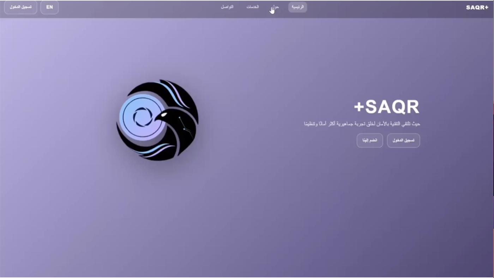

# SAQR+ | AI-based Crowd Monitoring and Decision Support at Stadium Gates

*Full project title: Saqr+: An AI-based Crowd Monitoring and Decision Support System for Real-time Proactive Alerting and Recommendations at Stadium Gates*

A graduation project built by a team of five: a system that monitors crowds at stadium gates in real time and issues proactive alerts and recommendations. **2nd place at the "Nahnu Hona 4" Graduation Projects Exhibition, Taibah University, 2026.**

> **This repository is a project showcase.** The source code and trained model weights are not published because the project is owned by the university.

## Videos

| Project introduction | Live demo |
|:---:|:---:|
|  |  |

## The problem

Knowing how many people are at a stadium gate, as it happens, is essential for safety and crowd management. Counting manually does not scale, and reacting only after a gate is already crowded is too late.

## The solution

SAQR+ is a real-time monitoring and decision support system for stadium gates, built by the team together:

1. A camera covers a gate entrance.
2. **SaqrNet**, a modified convolutional neural network built in PyTorch, counts the people in the video in real time.
3. Rule-based logic is applied in real time to the model's output.
4. The system issues **proactive alerts and recommendations**, such as opening another gate or redirecting the crowd to a different one.

"Proactive" here means the system raises the alert before a problem develops, instead of reacting after it has happened. It does not forecast future crowd levels.

## Results

Evaluated on the public **ShanghaiTech Part B** benchmark against the **CSRNet** baseline (lower is better):

| Model | MAE | MSE |
|-------|----:|----:|
| CSRNet (baseline) | 10.6 | 16.0 |
| **SaqrNet (ours)** | **10.32** | **15.80** |

- **2.6% lower MAE** than the baseline.
- **9.25 FPS** real-time inference on stadium footage.

## Data pipeline

Beyond the public benchmark, I built a preprocessing and annotation pipeline with OpenCV and Pandas, using footage collected locally from a sports club in Yanbu.

## My role

SAQR+ was built by the whole team. My part:

- **Team lead:** I coordinated tasks, handled communication with academic supervisors, and delivered the project on schedule.
- **Crowd counting model:** I designed and trained SaqrNet.
- **Data pipeline:** I built the preprocessing and annotation pipeline.
- **Project report:** I wrote the report in Word and revised it with the other members' input.

## Tech stack

Python · PyTorch · OpenCV · Pandas · NumPy · Computer Vision · CNN · Google Colab · Kaggle

## Follow the project

- X (Twitter): [@Saqr_plus](https://x.com/Saqr_plus)

## Author

**Shatha Alluhaibi**, Information Systems graduate, Taibah University (College of Computer Science and Engineering).
See my other project: [Secure Password Validator](https://github.com/ShathaF/secure-password-validator).

---

*All rights reserved. The videos, images and text in this repository are shared for portfolio purposes.*
